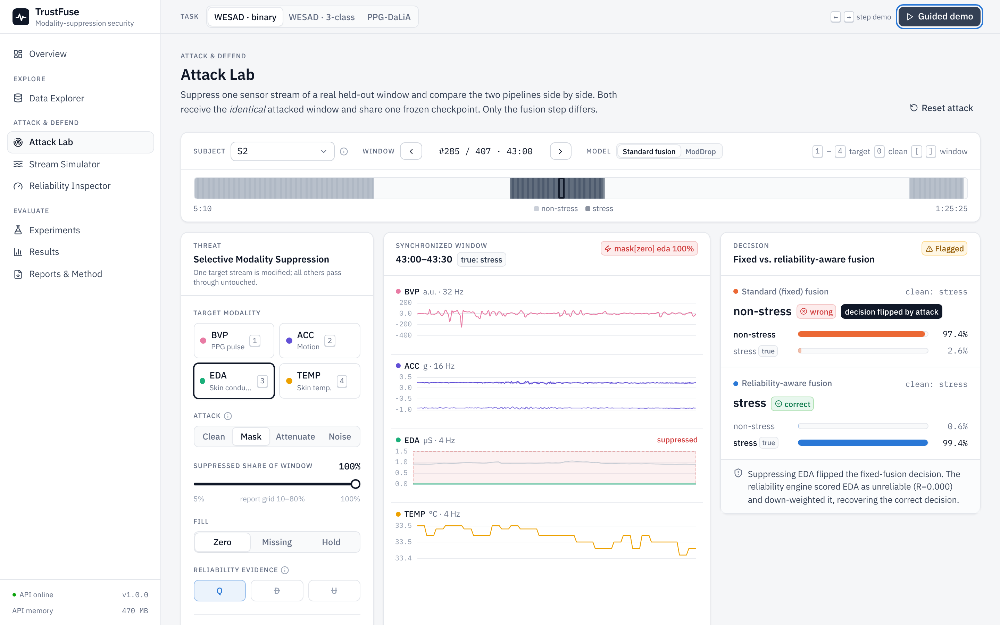

# TrustFuse

**Security evaluation of intentional modality suppression in wearable health AI:
a reliability-aware defense for multimodal physiological inference.**

Final-year project (BCSE497J, VIT SCOPE): Anish Jaiswal, Yash Sehrawat, Aryaman Katoch.
Supervised by Dr. Gladys Gnana Kiruba.

Wearable health models fuse several sensor streams. Robustness to *accidentally* missing data
does not tell us what happens when an attacker *deliberately* suppresses the one stream that
matters most. TrustFuse:

* turns this into a measurable attack, the **Selective Modality Suppression Attack (SMSA)**;
* quantifies how damaging and how detectable the attack is on **WESAD** and **PPG-DaLiA**;
* tests a **reliability-aware fusion** defense. The defense scores each modality from signal
  quality (Q), cross-modal disagreement (D) and predictive uncertainty (U), then re-weights
  fusion on the *same frozen model*.



<!-- HEADLINE:START -->
## Key findings (measured, 15 held-out subjects per dataset)

| Task | Clean macro-F1 | Targeted suppression: fixed → defended | Clean false flags | Hypotheses |
|---|---|---|---|---|
| WESAD stress vs. non-stress | 0.824 | 0.490 → 0.753 | 5.6% | H1✓ H2✓ H3✓ H4✓ |
| WESAD 3-class | 0.525 | 0.182 → 0.308 | 5.6% | H1✓ H2✗ H3✓ H4✓ |
| PPG-DaLiA activity (BVP+ACC) | 0.739 | 0.104 → 0.128 | 5.0% | H1✓ H2✓ H3✓ H4✓ |

* **Strategic suppression is a security problem, not just missing data.** On WESAD, removing one
  modality chosen by a label-free attacker drops fixed-fusion macro-F1 from 0.824 to
  **0.490**. Random modality loss with the same budget only reaches 0.691. The difference
  is 0.20 [0.14, 0.27], one-sided Wilcoxon p < 0.001, rank-biserial r = 0.94.
  Training for generic missingness (ModDrop) does not close this gap.
* **Reliability-aware fusion mitigates it on the same frozen model at no clean cost.**
  * EDA suppression: 0.610 → **0.817**; TEMP: 0.522 → **0.791** (both p = 0.002, Holm).
  * Targeted attacker: 0.490 → 0.753; oracle attacker: 0.387 → 0.740.
* **Calibrating against many people is what makes the flag usable.** Model-free signal-quality
  evidence with a subject-pooled conformal reference keeps clean false flags on new people at
  5.6% (target 5%). Calibrating on two people gave about 18–22%.
* **Honest limits.**
  * A defense-aware attacker still flips 25% of decisions without being flagged.
  * Gating discards a whole stream, so it cannot recover the strongest modality (BVP) and slightly
    over-reacts to mild partial BVP masking.
  * On two-modality PPG-DaLiA, losing ACC leaves too little information to recover.

Full tables and figures: [docs/RESULTS.md](docs/RESULTS.md).
<!-- HEADLINE:END -->

## Quick start (Windows, PowerShell)

Prerequisite: [Docker Desktop](https://www.docker.com/products/docker-desktop/), running. 1.5 GB
of Docker memory is enough: the stack uses ~0.4 GB idle and ~0.65 GB at peak.

```powershell
git clone https://github.com/sehrawaty/TrustFuse.git
cd TrustFuse
.\config-everything      # one time: checks Docker, verifies the data, builds both images, runs a self test
.\run                    # fresh start of the whole stack, opens http://localhost:8080
.\stop                   # stops and removes everything TrustFuse started
```

| Command | What it does | Options |
|---|---|---|
| `.\config-everything` | Checks Docker (starts Docker Desktop if needed), memory, disk and port. Creates `.env`, verifies the SHA-256 checksums of every processed data file, builds `trustfuse-api` and `trustfuse-web`, and runs an end-to-end smoke test inside the container. Safe to re-run. | `-NoCache` rebuild from scratch · `-FromRaw` download the original datasets and regenerate `data/processed` · `-SkipSmoke` |
| `.\run` | **Fresh start.** Removes the previous session's containers, network and runtime volume (user runs and jobs). Starts the stack, waits until it is healthy, and opens the browser. The shipped models and canonical results are never touched. | `-Logs` follow logs · `-NoBrowser` · `-Keep` keep the previous session's runs |
| `.\stop` | Stops and removes TrustFuse's containers, network and runtime volume, then verifies nothing is left. | `-All` also quits Docker Desktop and runs `wsl --shutdown` · `-Purge` also deletes the images |

The `.cmd` launchers call PowerShell with `-ExecutionPolicy Bypass`, so no policy change is
needed. They also work from `cmd.exe`. On macOS or Linux, use `./config-everything.sh`,
`./run.sh` and `./stop.sh`.

> First build: `config-everything` downloads the base images and CPU-only PyTorch (about 1 GB).
> It takes 5–15 minutes depending on your connection; later runs start in seconds.
> Before a presentation, run `.\config-everything` once while you have internet. After that,
> `.\run` works fully offline: fonts and libraries are bundled, and no CDN is used.

## What you can show

| Page | Demonstrates |
|---|---|
| **Overview** | The threat model, an interactive version of the system architecture (report Fig. 2), live H1–H4 outcomes, and headline numbers. |
| **Data Explorer** | All 30 subjects' synchronized wrist streams, protocol labels and evaluation windows, with zoom and full-resolution refetch. |
| **Attack Lab** | Pick a held-out window and suppress any modality (mask / attenuate / noise; zero, missing or frozen fill; any severity). Shows fixed vs. reliability-aware decisions, per-modality Q/D/U → R → weight, the low-confidence flag, and the runtime sequence (report Fig. 6) animated from the live trace. Also runs the "most damaging modality" and defense-aware attackers. |
| **Stream Simulator** | A whole session replayed window by window. Click to place a burst attack and see where fixed fusion fails and where the defense flags and recovers. |
| **Reliability Inspector** | The method's equations with live values, the frozen calibration distributions and thresholds, every signal-quality indicator, and Q/D/U ablation. |
| **Experiments** | Launch experiments from the browser (quick demo, re-evaluate frozen models, or full LOSO), with live training curves and logs streamed via Server-Sent Events. |
| **Results** | Hypothesis tests, baselines with CIs, vulnerability heatmap, severity and burst sweeps, the attacker ladder, the detection ROC and detectability matrix, per-subject forest plot, ablations, and a per-window manifest. |
| **Reports & Method** | Paper figures (PDF/SVG/PNG), LaTeX tables, raw result files, and the method write-up. |

Press **Guided demo** (top right) for an eight-step presentation tour that drives the real
application. Use ← → to step through it.

## Research design in one page

* **Threat.** SMSA modifies exactly one modality at inference time and passes every other
  stream through unchanged; unit tests assert byte identity. It covers:
  * masking: 10–100 % of the window, filled with zeros, missing samples or a frozen value;
  * attenuation;
  * stream-level bursts of 1–10 windows;
  * additive noise.

  Four attackers of increasing capability choose the modality: random, targeted (label-free),
  oracle (label-aware) and adaptive (aware of the defense).
* **Defense.** For each modality:
  * Q is a model-free signal-quality anomaly;
  * D is the disagreement of its unimodal head with the other heads;
  * U is MC-dropout uncertainty.

  Their sum is ranked against clean validation windows, giving a conformal reliability R. A
  flag fires when min R ≤ α/M, which bounds the clean false-rejection rate. A gate w replaces
  unreliable embeddings with a neutral reference before the same frozen classifier.
* **Protocol.** Leave-one-subject-out over 15 subjects per dataset, with 2 further held-out
  validation subjects per fold. Normalisation uses training subjects only, and calibration uses
  non-test subjects only. Fixed and defended pipelines see identical attacked windows.
* **Statistics.** Subject-cluster bootstrap 95 % CIs; paired Wilcoxon tests with Holm
  correction; Friedman with Kendall's W; rank-biserial effect sizes. Four pre-registered
  hypotheses (H1–H4).

Details: [docs/METHODOLOGY.md](docs/METHODOLOGY.md) · Measured results:
[docs/RESULTS.md](docs/RESULTS.md)

## Repository layout

```
config-everything.cmd / run.cmd / stop.cmd    Windows launchers (scripts/windows/*.ps1)
config-everything.sh  / run.sh  / stop.sh     macOS / Linux launchers (scripts/unix/common.sh)
docker-compose.yml                             api (FastAPI + PyTorch CPU) and web (nginx + React build)
backend/trustfuse/
  data/          DatasetLoader, Preprocessor, raw-archive conversion
  attacks/       AttackSimulator (SMSA)
  models/        FusionModel, unimodal baselines, trainer, checkpoints
  reliability/   ReliabilityEngine (Q, D, U -> conformal R -> gate)
  defense/       reliability-aware fusion
  evaluation/    Evaluator, metrics, statistics, hypotheses, figures, RESULTS.md
  experiments/   ExperimentConfig, training/evaluation runner, job manager, result store
  service/ api/  inference service and HTTP API (/api/docs)
backend/tests/   attack invariants, leakage control, conformal validity, metrics, API contract
web/             React + TypeScript UI (Vite, Tailwind, Radix, ECharts, KaTeX)
configs/         experiment definitions (YAML, hashed into every result)
data/processed/  WESAD + PPG-DaLiA wrist streams (see data/DATA_LICENSE.md)
artifacts/       trained LOSO fold models (+ frozen calibrations) and canonical result sets
docs/            METHODOLOGY.md, RESULTS.md, figures/, screenshots/
```

## Developing without Docker

```bash
cd backend && python -m venv .venv && . .venv/bin/activate     # Python 3.11 or 3.12
pip install -r requirements-dev.txt
python -m pytest -q                                              # 40 tests
python -m trustfuse serve --port 8000                            # API on :8000
cd ../web && npm ci && npm run dev                               # UI on :5173 (proxies /api)
```

To retrain and re-evaluate everything (about 1.5 h on 4 CPU cores):
`python -m trustfuse train wesad_binary wesad_3class dalia_activity --workers 3`, then
`python -m trustfuse evaluate wesad_binary wesad_3class dalia_activity --workers 4`, then
`python -m trustfuse report`.

## Memory budget (measured)

| Situation | API container | Web container |
|---|---|---|
| Idle after start | ~220 MB | ~5 MB |
| Interactive use (Attack Lab, Stream Simulator) | ~300–420 MB | ~5 MB |
| Live "Quick demo" experiment (training + attack matrix) | peak ~650 MB | ~5 MB |
| Hard limits (`docker-compose.yml`) | 900 MB | 64 MB |

## Troubleshooting

* **"Docker is installed but not running"**: start Docker Desktop and retry. The scripts wait up
  to 3 minutes for it.
* **Port 8080 in use**: set `WEB_PORT=8090` in `.env` and run `.\run` again.
* **Limiting Docker's memory on Windows**: create `%UserProfile%\.wslconfig` containing
  `[wsl2]` and `memory=1536MB`, then run `wsl --shutdown`.
* **A run looks stuck**: `.\run -Logs` shows live container logs; `docker compose ps` shows health.

## Data and licences

Processed wrist streams derived from **WESAD** (Schmidt et al., ICMI 2018; academic,
non-commercial use) and **PPG-DaLiA** (Reiss et al., Sensors 2019; CC BY 4.0). Please cite both
datasets; see [data/DATA_LICENSE.md](data/DATA_LICENSE.md).
