# Results

Generated by `python -m trustfuse report` from the canonical result sets in `artifacts/results/`. Values are subject-level means over leave-one-subject-out folds with 95 % subject-bootstrap confidence intervals. A hypothesis that the data do not support is reported as not supported.

## WESAD · stress vs. non-stress

Result set `wesad_binary` · config `ee7a9b976dd1` · 15 LOSO folds · 6,361 test windows · seeds 0, 1, 2 · 14,220 measurements.

### Clean performance

| Model | Macro-F1 [95% CI] | Balanced accuracy |
|---|---|---|
| Fixed fusion | 0.824 [0.739, 0.895] | 0.833 [0.758, 0.900] |
| Reliability-aware fusion | 0.824 [0.739, 0.895] | 0.833 [0.758, 0.900] |
| ModDrop fusion | 0.836 [0.757, 0.907] | 0.840 [0.764, 0.912] |
| ModDrop + reliability-aware | 0.836 [0.756, 0.907] | 0.840 [0.764, 0.912] |
| Unimodal ACC | 0.682 [0.569, 0.779] | 0.696 [0.590, 0.789] |
| Unimodal BVP | 0.843 [0.800, 0.887] | 0.856 [0.811, 0.899] |
| Unimodal EDA | 0.599 [0.447, 0.752] | 0.673 [0.556, 0.795] |
| Unimodal TEMP | 0.562 [0.453, 0.663] | 0.651 [0.592, 0.710] |

### Hypotheses

| | Hypothesis | Outcome | Key evidence |
|---|---|---|---|
| H1 | Attack effectiveness | supported | significant for BVP, EDA, TEMP; largest drop TEMP 0.302 [0.225, 0.389] |
| H2 | Modality sensitivity | supported | ranking TEMP > EDA > BVP > ACC; p < 0.001, Kendall's W 0.46 |
| H3 | Mitigation without material clean loss | supported | clean cost 0.000 [-0.001, 0.001] (margin 0.02); mitigated: EDA, TEMP; mean gain over all attacks 0.008 [-0.004, 0.019] |
| H4 | Detectability of suppression | supported | clean FRR 5.6% [3.4%, 8.0%] (limit 10%); detectable: BVP, ACC, EDA, TEMP |

### Full suppression of one modality (full masking (zero-fill, severity 1))

| Suppressed | Fixed macro-F1 | Defended macro-F1 | Gain | p (Holm) | Detection AUROC |
|---|---|---|---|---|---|
| BVP | 0.703 [0.589, 0.811] | 0.702 [0.587, 0.812] | -0.001 [-0.005, 0.003] | 1.000 | 1.000 |
| ACC | 0.815 [0.727, 0.893] | 0.798 [0.711, 0.879] | -0.018 [-0.036, 0.000] | 1.000 | 1.000 [0.999, 1.000] |
| EDA | 0.610 [0.531, 0.699] | 0.817 [0.736, 0.885] | 0.207 [0.113, 0.299] | 0.002 | 1.000 |
| TEMP | 0.522 [0.470, 0.583] | 0.791 [0.709, 0.860] | 0.270 [0.186, 0.362] | 0.002 | 1.000 |

### Attacker capability

| Attacker | Fixed macro-F1 | Defended macro-F1 | Flagged | Evasive defended flips |
|---|---|---|---|---|
| Random | 0.691 [0.627, 0.753] | 0.785 [0.705, 0.856] | 100.0% | 0.0% |
| Targeted | 0.490 [0.447, 0.530] | 0.753 [0.657, 0.836] | 100.0% | 0.0% |
| Oracle | 0.387 [0.334, 0.435] | 0.740 [0.638, 0.830] | 100.0% | 0.0% |
| Adaptive (defense-aware) | 0.699 [0.630, 0.766] | 0.698 [0.629, 0.765] | 5.3% [3.2%, 7.7%] | 25.4% [18.3%, 32.9%] |

Targeted versus random suppression: macro-F1 difference 0.201 [0.136, 0.269], one-sided Wilcoxon p < 0.001.

### Robustness training (ModDrop) versus the defense

| Attack family | Fusion fixed | Fusion defended | ModDrop fixed | ModDrop defended |
|---|---|---|---|---|
| mask | 0.777 [0.700, 0.844] | 0.781 [0.699, 0.853] | 0.789 [0.720, 0.854] | 0.791 [0.719, 0.862] |
| attenuate | 0.771 [0.691, 0.838] | 0.802 [0.720, 0.872] | 0.790 [0.720, 0.856] | 0.819 [0.747, 0.884] |
| targeted | 0.490 [0.447, 0.530] | 0.753 [0.657, 0.836] | 0.529 [0.437, 0.632] | 0.777 [0.658, 0.882] |
| oracle | 0.387 [0.334, 0.435] | 0.740 [0.638, 0.830] | 0.388 [0.320, 0.455] | 0.711 [0.586, 0.827] |
| adaptive | 0.699 [0.630, 0.766] | 0.698 [0.629, 0.765] | 0.746 [0.703, 0.795] | 0.745 [0.702, 0.794] |
| random_drop | 0.691 [0.627, 0.753] | 0.785 [0.705, 0.856] | 0.722 [0.663, 0.776] | 0.805 [0.743, 0.865] |

### Figures

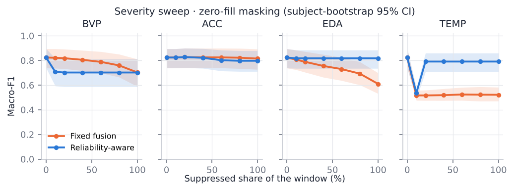
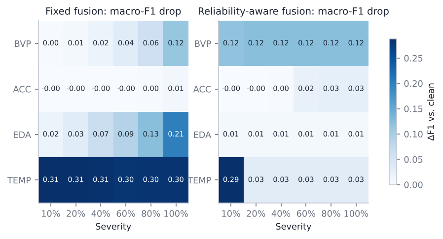
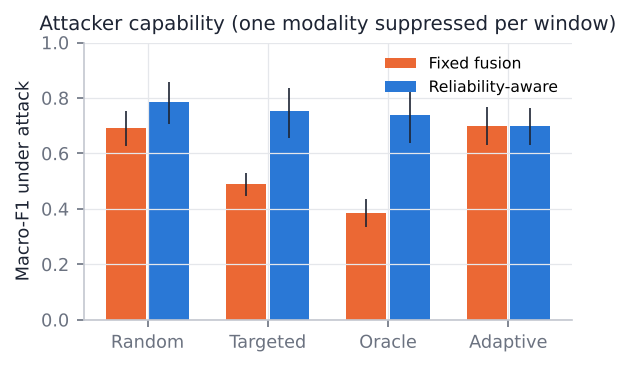
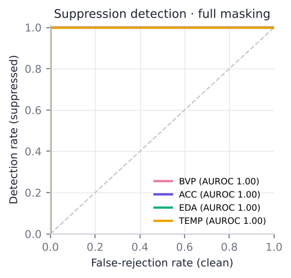
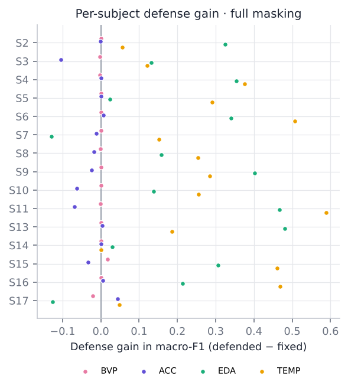
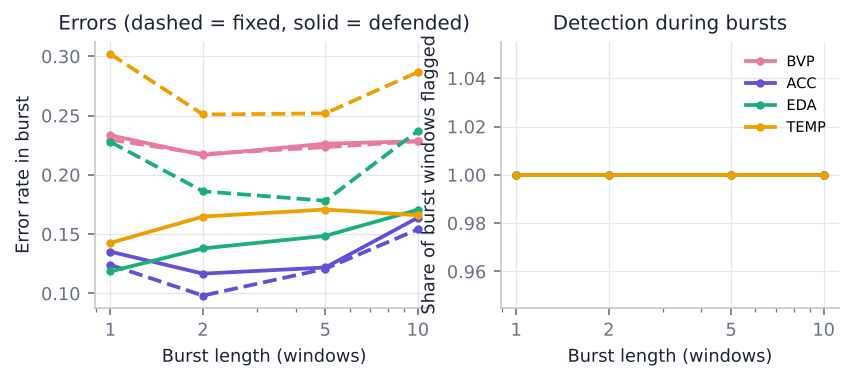

## WESAD · baseline / stress / amusement

Result set `wesad_3class` · config `31114a76408a` · 15 LOSO folds · 6,361 test windows · seeds 0 · 7,140 measurements.

### Clean performance

| Model | Macro-F1 [95% CI] | Balanced accuracy |
|---|---|---|
| Fixed fusion | 0.525 [0.444, 0.603] | 0.563 [0.505, 0.624] |
| Reliability-aware fusion | 0.524 [0.444, 0.602] | 0.563 [0.506, 0.623] |
| ModDrop fusion | 0.526 [0.439, 0.620] | 0.554 [0.476, 0.637] |
| ModDrop + reliability-aware | 0.526 [0.440, 0.619] | 0.553 [0.476, 0.636] |
| Unimodal ACC | 0.531 [0.423, 0.640] | 0.571 [0.463, 0.677] |
| Unimodal BVP | 0.548 [0.487, 0.609] | 0.585 [0.533, 0.638] |
| Unimodal EDA | 0.401 [0.282, 0.528] | 0.499 [0.405, 0.601] |
| Unimodal TEMP | 0.365 [0.263, 0.477] | 0.461 [0.389, 0.543] |

### Hypotheses

| | Hypothesis | Outcome | Key evidence |
|---|---|---|---|
| H1 | Attack effectiveness | supported | significant for BVP, EDA, TEMP; largest drop TEMP 0.248 [0.176, 0.315] |
| H2 | Modality sensitivity | not supported | ranking TEMP > BVP > EDA > ACC; p 0.127, Kendall's W 0.13 |
| H3 | Mitigation without material clean loss | supported | clean cost 0.001 [-0.002, 0.004] (margin 0.02); mitigated: TEMP; mean gain over all attacks -0.010 [-0.026, 0.008] |
| H4 | Detectability of suppression | supported | clean FRR 5.6% [3.4%, 8.0%] (limit 10%); detectable: BVP, ACC, EDA, TEMP |

### Full suppression of one modality (full masking (zero-fill, severity 1))

| Suppressed | Fixed macro-F1 | Defended macro-F1 | Gain | p (Holm) | Detection AUROC |
|---|---|---|---|---|---|
| BVP | 0.343 [0.269, 0.428] | 0.343 [0.268, 0.429] | 0.000 [-0.002, 0.002] | 1.000 | 1.000 |
| ACC | 0.439 [0.358, 0.516] | 0.432 [0.347, 0.514] | -0.007 [-0.041, 0.023] | 1.000 | 1.000 [0.999, 1.000] |
| EDA | 0.419 [0.337, 0.502] | 0.518 [0.440, 0.597] | 0.099 [0.003, 0.188] | 0.142 | 1.000 |
| TEMP | 0.277 [0.207, 0.357] | 0.488 [0.421, 0.557] | 0.211 [0.135, 0.279] | < 0.001 | 1.000 |

### Attacker capability

| Attacker | Fixed macro-F1 | Defended macro-F1 | Flagged | Evasive defended flips |
|---|---|---|---|---|
| Random | 0.424 [0.371, 0.468] | 0.466 [0.408, 0.521] | 100.0% | 0.0% |
| Targeted | 0.182 [0.130, 0.235] | 0.308 [0.244, 0.388] | 100.0% | 0.0% |
| Oracle | 0.044 [0.018, 0.079] | 0.320 [0.251, 0.400] | 100.0% | 0.0% |
| Adaptive (defense-aware) | 0.413 [0.344, 0.477] | 0.412 [0.345, 0.476] | 5.3% [3.2%, 7.7%] | 58.0% [46.3%, 68.0%] |

Targeted versus random suppression: macro-F1 difference 0.242 [0.176, 0.306], one-sided Wilcoxon p < 0.001.

### Robustness training (ModDrop) versus the defense

| Attack family | Fusion fixed | Fusion defended | ModDrop fixed | ModDrop defended |
|---|---|---|---|---|
| mask | 0.477 [0.410, 0.540] | 0.455 [0.398, 0.508] | 0.494 [0.415, 0.579] | 0.516 [0.432, 0.603] |
| attenuate | 0.484 [0.411, 0.555] | 0.508 [0.434, 0.579] | 0.490 [0.410, 0.571] | 0.519 [0.441, 0.603] |
| targeted | 0.182 [0.130, 0.235] | 0.308 [0.244, 0.388] | 0.378 [0.279, 0.475] | 0.552 [0.441, 0.665] |
| oracle | 0.044 [0.018, 0.079] | 0.320 [0.251, 0.400] | 0.154 [0.100, 0.211] | 0.441 [0.357, 0.534] |
| adaptive | 0.413 [0.344, 0.477] | 0.412 [0.345, 0.476] | 0.507 [0.420, 0.594] | 0.505 [0.418, 0.592] |
| random_drop | 0.424 [0.371, 0.468] | 0.466 [0.408, 0.521] | 0.473 [0.400, 0.548] | 0.535 [0.459, 0.616] |

### Figures

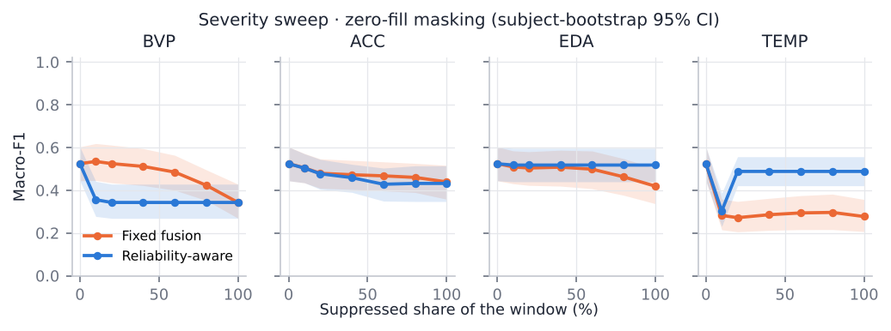
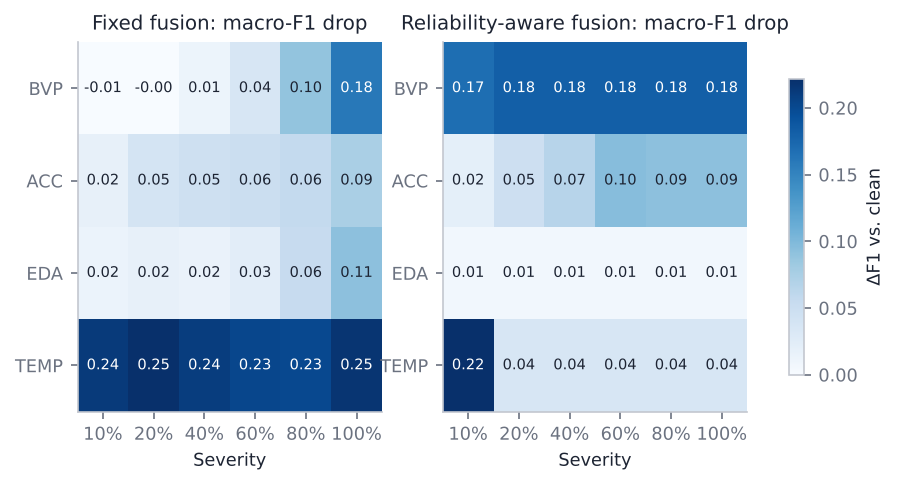
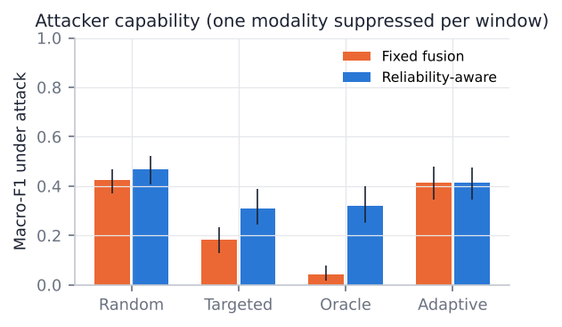
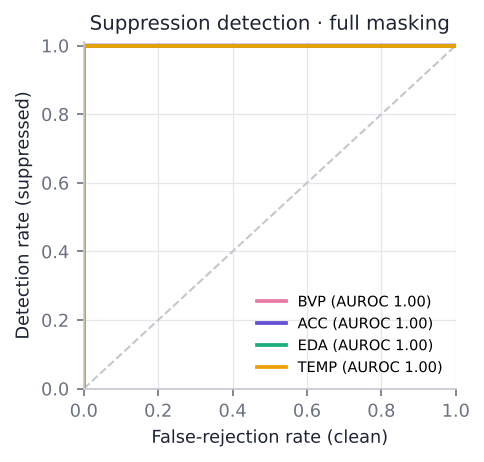
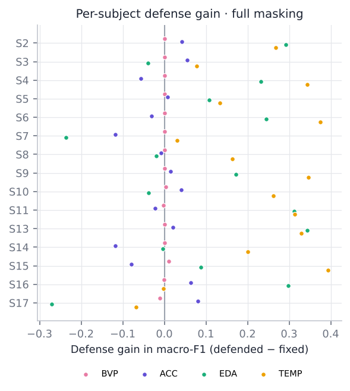
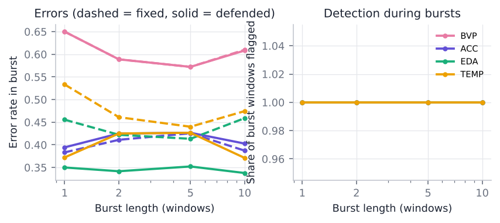

## PPG-DaLiA · activity (BVP + ACC)

Result set `dalia_activity` · config `99192cdf5297` · 15 LOSO folds · 23,379 test windows · seeds 0 · 3,750 measurements.

### Clean performance

| Model | Macro-F1 [95% CI] | Balanced accuracy |
|---|---|---|
| Fixed fusion | 0.739 [0.676, 0.791] | 0.755 [0.698, 0.804] |
| Reliability-aware fusion | 0.738 [0.674, 0.790] | 0.753 [0.695, 0.803] |
| ModDrop fusion | 0.748 [0.686, 0.801] | 0.772 [0.718, 0.820] |
| ModDrop + reliability-aware | 0.747 [0.685, 0.800] | 0.771 [0.715, 0.818] |
| Unimodal ACC | 0.724 [0.666, 0.780] | 0.754 [0.699, 0.807] |
| Unimodal BVP | 0.386 [0.333, 0.433] | 0.425 [0.379, 0.469] |

### Hypotheses

| | Hypothesis | Outcome | Key evidence |
|---|---|---|---|
| H1 | Attack effectiveness | supported | significant for BVP, ACC; largest drop ACC 0.591 [0.535, 0.639] |
| H2 | Modality sensitivity | supported | ranking ACC > BVP; p < 0.001 |
| H3 | Mitigation without material clean loss | supported | clean cost 0.002 [-0.000, 0.004] (margin 0.02); mitigated: ACC; mean gain over all attacks -0.115 [-0.134, -0.100] |
| H4 | Detectability of suppression | supported | clean FRR 5.0% [3.9%, 6.3%] (limit 10%); detectable: BVP, ACC |

### Full suppression of one modality (full masking (zero-fill, severity 1))

| Suppressed | Fixed macro-F1 | Defended macro-F1 | Gain | p (Holm) | Detection AUROC |
|---|---|---|---|---|---|
| BVP | 0.497 [0.411, 0.587] | 0.491 [0.406, 0.581] | -0.005 [-0.009, -0.002] | 0.997 | 1.000 |
| ACC | 0.148 [0.128, 0.173] | 0.180 [0.144, 0.216] | 0.032 [0.008, 0.058] | 0.010 | 1.000 |

### Attacker capability

| Attacker | Fixed macro-F1 | Defended macro-F1 | Flagged | Evasive defended flips |
|---|---|---|---|---|
| Random | 0.414 [0.362, 0.464] | 0.420 [0.366, 0.471] | 100.0% | 0.0% |
| Targeted | 0.104 [0.079, 0.136] | 0.128 [0.100, 0.159] | 100.0% | 0.0% |
| Oracle | 0.039 [0.023, 0.056] | 0.077 [0.052, 0.105] | 100.0% | 0.0% |
| Adaptive (defense-aware) | 0.538 [0.479, 0.593] | 0.537 [0.478, 0.592] | 4.3% [3.3%, 5.5%] | 50.8% [46.1%, 55.1%] |

Targeted versus random suppression: macro-F1 difference 0.310 [0.268, 0.349], one-sided Wilcoxon p < 0.001.

### Robustness training (ModDrop) versus the defense

| Attack family | Fusion fixed | Fusion defended | ModDrop fixed | ModDrop defended |
|---|---|---|---|---|
| mask | 0.586 [0.528, 0.637] | 0.420 [0.371, 0.465] | 0.639 [0.584, 0.688] | 0.591 [0.537, 0.641] |
| attenuate | 0.600 [0.543, 0.649] | 0.580 [0.526, 0.629] | 0.617 [0.559, 0.665] | 0.632 [0.570, 0.684] |
| targeted | 0.104 [0.079, 0.136] | 0.128 [0.100, 0.159] | 0.135 [0.106, 0.169] | 0.350 [0.287, 0.416] |
| oracle | 0.039 [0.023, 0.056] | 0.077 [0.052, 0.105] | 0.096 [0.076, 0.116] | 0.323 [0.275, 0.373] |
| adaptive | 0.538 [0.479, 0.593] | 0.537 [0.478, 0.592] | 0.562 [0.499, 0.617] | 0.562 [0.499, 0.617] |
| random_drop | 0.414 [0.362, 0.464] | 0.420 [0.366, 0.471] | 0.510 [0.468, 0.551] | 0.535 [0.480, 0.590] |

### Figures

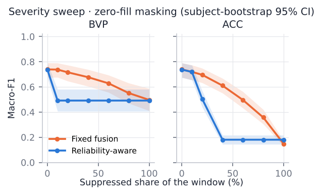
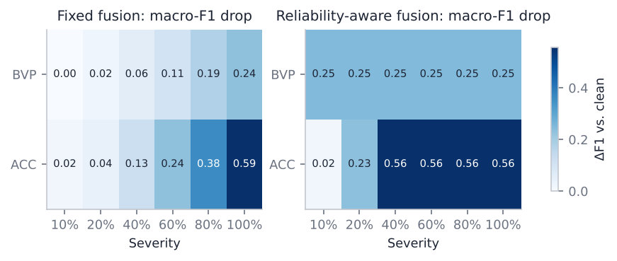
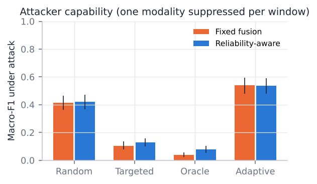
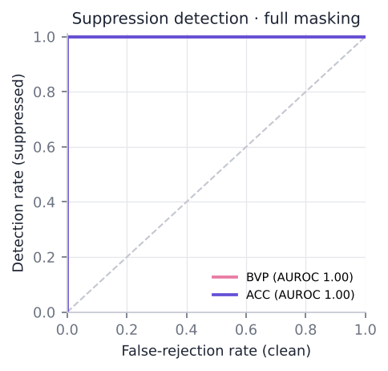
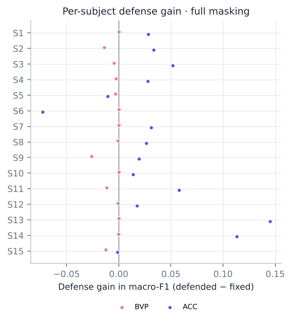
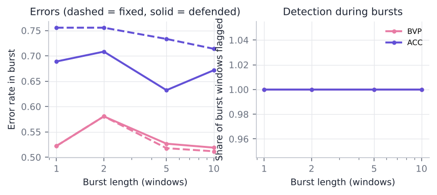
